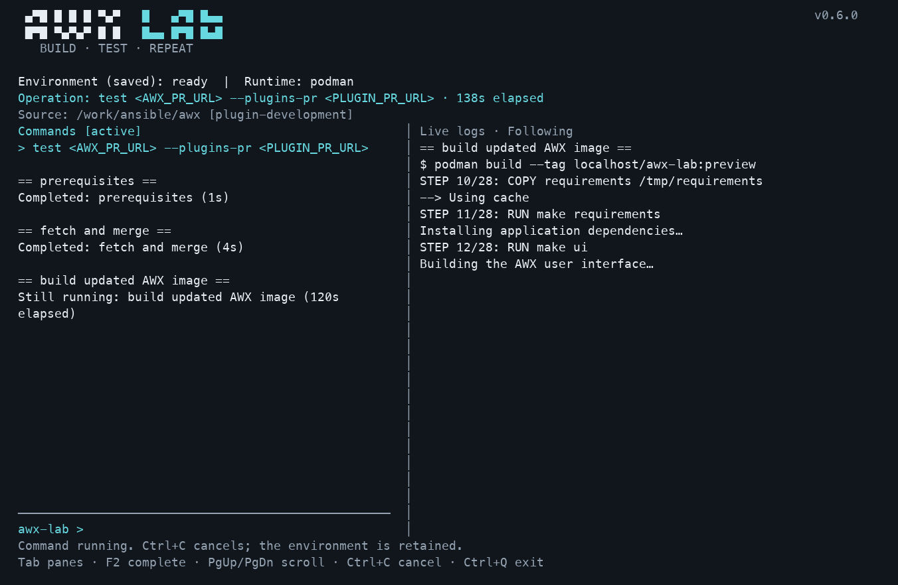

# AWX Lab

Build a local AWX environment once, then test AWX and awx-plugins changes from GitHub PRs or your uncommitted working files. AWX Lab builds the image, deploys it through kind and AWX Operator, runs basic checks, and leaves AWX running for manual feature testing.

## Quick start

You need **Python 3.11+ and Git**. AWX Lab targets **macOS Apple Silicon and Linux x86_64**, with Podman or Docker. Plan for 4–8 CPUs, 12–16 GiB RAM available to the runtime and at least 40 GiB free workspace disk, plus runtime storage. See [requirements](docs/user-guide.md#requirements) for details.

```bash
git clone https://github.com/eco-ansible-content/awx-lab.git
cd awx-lab
./awx-lab prereq install
./awx-lab
```

The prerequisite installer lists missing tools and asks for approval. On macOS, install Homebrew first if you want it to manage packages. In the terminal view, type **`up`** in the left pane to create or resume the lab; the right pane follows the full log. Opening the view does not start a deployment. The first build takes time; later runs reuse the lab. You can also run `./awx-lab up` directly.

After success, open the printed AWX URL and sign in with the **username and password shown in the terminal**. The same login is saved in the logs.

Test a PR (replace the example with your open PR):

```bash
./awx-lab test https://github.com/ansible/awx-plugins/pull/456
```

To make `awx-lab` available from any directory, install [pipx](https://github.com/pypa/pipx#install-pipx), then run from this clone:

```bash
pipx install .
pipx ensurepath
```

Open a new terminal if your PATH changed. The examples below use the installed `awx-lab` command. Without installation, use `./awx-lab` from this clone or `/path/to/awx-lab/awx-lab` from another directory. The repository launcher requires Python; it does not require pip or pipx.

## Interactive terminal

Run **`awx-lab`** with no command to open the console and live logs. Inside, type `up`, `test <PR_URL>`, `test --local`, `credentials`, or `down`. Existing direct commands remain available for scripts and one-off use.



- **Tab** switches panes; **F2** completes commands/options; **↑/↓** recall command history.
- **PgUp/PgDn** scroll; scrolling logs pauses following. **End** in logs or `follow` resumes it.
- **Ctrl+C** cancels the active command. `exit` or **Ctrl+Q** leaves the view and keeps the lab. During active work, choose `cancel` or `stay`.
- Narrow terminals show one pane at a time. Type `help` or `help test` for commands and controls.

Local tests use the directory where you opened the interface, shown with its Git branch. Open `awx-lab` from your AWX/plugin checkout for `test --local`. This is an AWX Lab console; shell commands such as `git` and `cd` are unsupported. See the [terminal guide](docs/terminal-interface.md).

## Test your changes

### PR mode: AWX, plugins, or both

```bash
# AWX PR only
awx-lab test https://github.com/ansible/awx/pull/123

# Plugin PR with the lab's baseline AWX ref
awx-lab test https://github.com/ansible/awx-plugins/pull/456

# AWX and plugin PRs together in one image
awx-lab test https://github.com/ansible/awx/pull/123 \
  --plugins-pr https://github.com/ansible/awx-plugins/pull/456
```

Each PR is merged with its own latest target branch. Plugin-only tests use the lab's baseline AWX ref; add `--awx-ref REF` to select another AWX branch, tag or SHA. Switching to an AWX-only test removes a previous custom plugin override.

AWX Lab executes selected source during image builds and in the local cluster. Test PRs and local branches only from contributors you trust; the lab is not a sandbox for arbitrary code.

### Local mode: test before committing

From your AWX or awx-plugins source checkout:

```bash
awx-lab test --local
# Optionally require this local branch to be checked out:
awx-lab test --local my-feature
```

Saved staged/unstaged changes and non-ignored new files are included. The CLI snapshots your files without changing your checkout or requiring a commit. An explicit branch must exist and already be checked out. Local mode supports **one checkout per invocation**; combining two local checkouts or mixing local changes with a PR is not supported.

PR mode and local mode are alternatives. See [source selection and local limitations](docs/user-guide.md#daily-workflow).

## Daily commands

| Command | Purpose |
| --- | --- |
| `awx-lab up` | Create or resume the lab; preserve the selected image and database |
| `awx-lab test …` | Update AWX for the selected changes; reuse the cluster, URL and database |
| `awx-lab test … --suite job` | Also run an Ansible localhost ping job |
| `awx-lab test … --no-cache` | Force a fresh AWX/UI build |
| `awx-lab credentials` | Retrieve the login again; print it and save it in the log |
| `awx-lab status` | Show saved environment state |
| `awx-lab logs --follow` | Follow detailed output in another terminal |
| `awx-lab down` | Stop the lab and keep its data |
| `awx-lab down --purge` | Destroy the lab, its database and managed files |
| `awx-lab <command> --help` | Show flags and examples |

Run `up` before testing, including after `down`. Changed sources rebuild; unchanged sources reuse the image and rerun checks. Database migrations can change retained data, and failed updates are not rolled back automatically.

**`Result: ready` means basic checks passed and AWX is available for your manual testing.** Checks cover the API, admin authentication, credential type registration and, for plugin tests, the installed wheel hash. This is not the full AWX regression suite or proof that your feature works.

## Logs and credentials

Default output shows concise setup progress, elapsed updates and test results. Add `--full-log` to `up` or `test` for raw build/deployment output. `--error-log` shows only failures and stays silent on success; the two flags are mutually exclusive.

All modes save detailed logs, including the **AWX username and password after successful checks**. Read them with `awx-lab logs` or `awx-lab logs --follow`. A failure prints its stage and report location; the lab remains available for investigation. See [logs and reports](docs/user-guide.md#logs-and-reports).

## Update

From the AWX Lab clone:

```bash
git pull --ff-only
# If installed from this clone with pipx:
pipx reinstall awx-lab
```

Running directly through `./awx-lab` uses the updated source immediately. Updating the CLI preserves the environment and data. See [other installation/update methods](docs/user-guide.md#installation-and-updates).

## Supported platforms

Targets: **macOS ARM64 and Linux x86_64**, with native Podman/Docker images. Windows, Intel Macs, Linux ARM64 and cross-architecture emulation are outside the current target matrix.

This is an early implementation. macOS ARM64/Podman baseline and AWX PR API checks have passed live testing. A teammate also reported a successful plugin PR run; its platform and full test coverage have not yet been recorded. Other combinations and scenarios need acceptance testing. See the [validation record](docs/validation.md) and [platform details](docs/user-guide.md#supported-platforms).

## More documentation

- [Website source and preview instructions](site/README.md): illustrated overview, interactive examples and the full documentation site, ready for GitHub Pages.
- [Full user guide](docs/user-guide.md): prerequisites, all flags, configuration, reports, storage and troubleshooting.
- [Troubleshooting](docs/user-guide.md#troubleshooting): runtime connectivity, resource limits, failed builds and deployment recovery.
- [Development](docs/user-guide.md#development): tests, packaging and editable installation.
- [Design and Bill's baseline](docs/design.md), [validation](docs/validation.md), and [backlog](docs/backlog.md).
