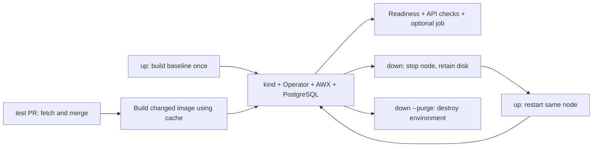

# Design and Bill's baseline

The selected architecture is a local CLI driving kind and AWX Operator. Bill's guide documents Docker Compose. We reuse its source/dependency workflow and AWX's own Dockerfile generation, then build the Kubernetes application image and deploy it with the operator.

Bare `awx-lab` presents this workflow in a native terminal console with commands and live logs, while direct CLI commands remain available. The [terminal design](../DESIGN.md) records its implemented palette, responsive layout and interaction rules; the [terminal guide](terminal-interface.md) covers operation and controls.

| Bill's guide | AWX Lab |
| --- | --- |
| Clone and push an awx-plugins branch | Fetch an open PR and merge with the current target branch locally |
| Edit the Git dependency URL | Build the merged plugin as a wheel and preserve the original extras |
| Disable caching to refetch a moving branch | Fetch and merge before each test, then install the exact wheel after the cached base dependency layer |
| `make docker-compose-build` | Render with `make Dockerfile`, then run the equivalent Kubernetes image build with Podman or Docker |
| Uncertain separate `make ui/build` step | Use the generated production Dockerfile's UI build stage; `--headless` is opt-in |
| `make docker-compose` | Create kind and deploy through AWX Operator |
| Interactive createsuperuser | Read the admin credentials created by the operator |
| `pip show` | Check the installed wheel's SHA256 in PEP 610 metadata |
| Host-specific licensing/cgroup edits | No general application patch inferred from those workarounds; failures retain diagnostics for investigation |

Build tooling is packaged in a helper image. The host CLI uses Python's standard library and calls the installed Git, runtime, kind and kubectl binaries. This avoids nested container engines, container socket mounts into the build helper, and architecture-specific host Ansible installations. The full lab consists of multiple containers even though one command orchestrates it.

For Podman on Linux, helper bind mounts use `:Z` for private SELinux labels. On macOS, Podman machine shares can reject relabeling with `lsetxattr: permission denied`; helpers mount the checkout without `:Z` and use `--security-opt label=disable` for that container only. Helpers retain the user ID mapping and run without privileged mode or a runtime socket mount. The VM's global SELinux configuration is not changed.

On macOS ARM64 with Podman, helpers and the Operator also set `OPENSSL_armcap=0` to avoid a reproduced cryptography/OpenSSL `SIGILL` crash under the Apple Hypervisor VM. This uses OpenSSL's portable implementations in build and Operator tooling; it does not change AWX's dependencies or deployment environment. See [OpenSSL's CPU capability override](https://docs.openssl.org/master/man3/OPENSSL_armcap/) and [Podman's volume labeling documentation](https://docs.podman.io/en/stable/markdown/podman-run.1.html#volume-v-source-volume-host-dir-container-dir-options).

Managed source checkouts restore regular files to the Git index modes (0644 or 0755) and source directories to 0755 after checkout/merge. The CLI's private umask otherwise produces owner-only files that become unreadable or unexecutable when copied as root into an image running as UID 1000. The enclosing run directory stays private; `.git`, reports and symlink targets are untouched.

`up` fetches a baseline AWX ref (`devel` by default), builds it and creates one environment. The CLI saves its internal identity in `current.json`. Every normal command resolves that selection, independent of the terminal's working directory. Unique internal names prevent collision with other kind clusters; users do not pass those names.

`test <PR_URL>` selects the PR at test time, fetching current head/target revisions into managed checkouts and preserving Git objects. Switching PRs resets the old merged source before preparing the new merge. A prior plugin override is removed when the next selection omits it. The Operator, database, credentials and URL remain; infrastructure settings belong to the original `up`. A root lock covers creation and selection, and each environment also retains its own lock.

`test --local [BRANCH]` selects the current AWX or awx-plugins Git working checkout, including uncommitted changes. An explicit branch must already be checked out. Discovery is read-only and occurs before lab state creation or runtime access; a later snapshot revalidates the branch/HEAD. No target merge is inferred. A local AWX snapshot supplies the complete AWX source; a local plugin snapshot supplies the wheel with the configured baseline AWX ref. The existing update, readiness, checks and failure-recovery pipeline then runs unchanged.

Local capture enumerates index-tracked and non-ignored untracked files, copies their current contents/modes into the managed checkout, and rechecks a content manifest plus branch identity to reject concurrent edits. Deleted files stay deleted. Links are copied without dereferencing and must remain within the checkout. The original index, branch, hooks and Git configuration are never copied or changed. Local history/tags are fetched into the disposable checkout for versioning; a deterministic synthetic commit records changed files there, enabling the existing Git-tree UI cache to detect uncommitted UI changes. Reports label local source metadata explicitly and record the original HEAD plus snapshot commit/tree and SHA256 content fingerprint. Generated build files are removed before the next snapshot, and local/PR transitions reuse the managed Git object store. This does not add live mounting, automatic base merging or database rollback.

The compiled upstream UI stage is cached separately by architecture, rendered UI instructions and tracked source content. Backend Python files outside `awx/ui/` are excluded from that fingerprint, so changing them alone does not repeat the UI build. Other AWX source changes invalidate the UI cache conservatively. External UI refs stay pinned to their cached build until `--no-cache` or a relevant source change rebuilds it. The backend image still rebuilds changed source layers; plugin wheels are installed after the base dependencies to preserve that cache too.

Podman application images are exported with `podman save --format docker-archive` and imported with `kind load image-archive`. kind v0.33.0's `load docker-image` command invokes Docker to inspect and save images even when the cluster provider is Podman; that command is used only for the Docker runtime. The temporary archive lives in the environment workspace and is removed after success, failure or Ctrl-C. An import failure stops deployment or rollout, preserving the image and cluster for retry. See the [kind loader source](https://github.com/kubernetes-sigs/kind/blob/v0.33.0/pkg/cmd/kind/load/docker-image/docker-image.go#L195-L213) and [Podman save documentation](https://docs.podman.io/en/v5.5.0/markdown/podman-save.1.html).

The Operator overlay uses a recognized `kustomization.yaml` filename (with JSON syntax), relies on the namespace provided by the upstream base, and redirects the retired Kubebuilder proxy image repository to `quay.io/brancz/kube-rbac-proxy` while retaining its tag. The shared image pull policy is `IfNotPresent`, allowing supporting images to download while AWX uses its imported image.

Each update uses a unique image tag. The CLI loads it into kind, patches the AWX image and web readiness settings and waits until both web and task deployments report the requested image, observed generation and complete ready replica counts. A pending update is saved before rollout; an interrupted or failed rollout forces a subsequent update rather than allowing tests against an older healthy deployment. A test never deletes the environment on failure. A per-run lock excludes simultaneous updates or cleanup, and previous reports are archived.

Retention records the last two successful image/build pairs after all requested checks pass. On success it removes older tracked AWX/UI tags, preserving current/pending images and required UI caches. Inside the label-selected kind nodes, it checks active pod references, CRI container references and every image alias before removal. CRI removal deletes all aliases of an image, so an image with any retained/untracked tag, digest reference or pinned status is skipped; see [containerd's image removal implementation](https://github.com/containerd/containerd/blob/main/internal/cri/server/images/image_remove.go). Removal is verified before deleting host tags, without force or parent-cache pruning. Partial failures preserve tracking for retry and produce warnings. The database, shared helper images, dependency cache and unrelated resources are outside this cleanup.

Report/diagnostic history retains ten archives after every attempt. Streamed disk logs retain at most four 10 MiB files, including migration of an oversized legacy log; terminal output is not truncated. Log following drains the old file and reopens after rotation. Git's NUL-separated tree metadata is excluded from build logs. Failed-run images stay until the next successful operation, so this policy is not a hard storage cap.

Lifecycle terminal output has three per-invocation modes: clean (default), error-only and full. Runner messages carry explicit levels; subprocess output is detail, setup/test stages and results are visible in clean mode, and command failures reach the CLI error handler with phase/report context. This avoids treating successful output such as “0 errors” or failed optional image probes as actual failures. Each stage reports its start, successful completion time and elapsed time every 30 seconds while running. A stoppable background reporter covers silent commands and API waits; writes are serialized with subprocess output and log rotation. All modes retain unfiltered, rotated disk logs. Successful up/test summaries and the credentials command intentionally print and log the AWX username/password; other sensitive subprocess output remains suppressed. The verified login is held only in memory until the summary, not stored in JSON state/reports, and is reset between invocations. Failed sensitive subprocesses also redact their output from exception messages. Mutually exclusive flags are accepted on up/test/down, and are never persisted as environment settings. Log-reading commands remain unfiltered and prerequisite-install approval remains unchanged.

`down` stops the label-selected node container and verifies it stopped, preserving the cluster filesystem and volumes. `up` starts the same container, exports a private kubeconfig and waits for Kubernetes and AWX readiness; failure does not trigger destructive recreation. `down --purge` removes the cluster/database, tracked per-environment AWX/UI images and workspace. Shared runtime caches and the runtime VM remain. Database snapshots and live source mounting are not implemented. Source revisions, wheel hashes and image IDs are recorded, but supporting dependencies still include upstream mutable references.

The AWX resource disables Nginx's IPv6 listener for the lab's IPv4 access model and enables the Operator's HTTP readiness probe (10-second period, 5-second timeout). Every deployment readiness wait first reconciles only those web settings, including resume and unchanged-source test paths. This repairs older labs without overwriting their image selection, database or credentials. Readiness rejects an old web deployment lacking the configured HTTP probe even if its replica counters say Ready. The host-side API ping additionally retries connection resets/interrupted HTTP reads during startup; mutating API calls remain single-attempt.

The built-in checks have a deliberately limited contract: a working AWX API, valid admin login, registered credential types, the requested plugin artifact, and optionally one real localhost Ansible job. Feature-specific regression tests must be added separately. A failed build or deployment is reported as its failed stage, not represented as a completed application test.

Reference material inspected during implementation:

- [AWX Makefile](https://github.com/ansible/awx/blob/devel/Makefile)
- [AWX Dockerfile template](https://github.com/ansible/awx/blob/devel/tools/ansible/roles/dockerfile/templates/Dockerfile.j2)
- [AWX plugin dependency file](https://github.com/ansible/awx/blob/devel/requirements/requirements_git.txt)
- [AWX Operator 2.19.1 configuration](https://github.com/ansible/awx-operator/tree/2.19.1/config)
- [kind quick start](https://kind.sigs.k8s.io/docs/user/quick-start/)
- [kind Podman restart issue](https://github.com/kubernetes-sigs/kind/issues/2272) (historical issue still open; stop/resume needs runtime acceptance tests)
- [kind rootless requirements](https://kind.sigs.k8s.io/docs/user/rootless/)

Bill's attachment is the project baseline, not a script to execute verbatim. Its optional host-specific workarounds require a reproduced failure before adoption.
