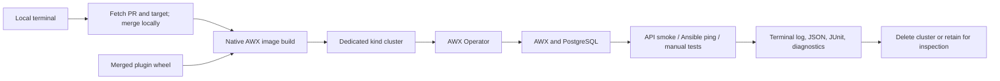

# Design and Bill's baseline

The selected architecture is a local CLI driving kind and AWX Operator. Bill's guide documents Docker Compose. We reuse its source/dependency workflow and AWX's own Dockerfile generation, then build the Kubernetes application image and deploy it with the operator.

| Bill's guide | AWX Lab |
| --- | --- |
| Clone and push an awx-plugins branch | Fetch an open PR and merge with the current target branch locally |
| Edit the Git dependency URL | Build the merged plugin as a wheel and preserve the original extras |
| Disable caching to refetch a moving branch | Copy the wheel before installation, invalidating the dependency layer when its bytes change |
| `make docker-compose-build` | Render with `make Dockerfile`, then run the equivalent Kubernetes image build with Podman or Docker |
| Uncertain separate `make ui/build` step | Use the generated production Dockerfile's UI build stage; `--headless` is opt-in |
| `make docker-compose` | Create kind and deploy through AWX Operator |
| Interactive createsuperuser | Read the admin credentials created by the operator |
| `pip show` | Check the installed wheel's SHA256 in PEP 610 metadata |
| Host-specific licensing/cgroup edits | No general application patch inferred from those workarounds; failures retain diagnostics for investigation |

Build tooling is packaged in a helper image. The host CLI uses Python's standard library and calls the installed Git, runtime, kind and kubectl binaries. This avoids nested container engines, container socket mounts into the build helper, and architecture-specific host Ansible installations. The full lab consists of multiple containers even though one command orchestrates it.

Each invocation is independent. A fresh database is the initial default; persistent datasets and hot-reload sessions are not yet implemented. Source revisions, wheel hashes and image IDs are recorded, but supporting dependencies still include upstream mutable references.

The built-in checks have a deliberately limited contract: a working AWX API, valid admin login, registered credential types, the requested plugin artifact, and optionally one real localhost Ansible job. Feature-specific regression tests must be added separately. A failed build or deployment is reported as its failed stage, not represented as a completed application test.

Reference material inspected during implementation:

- [AWX Makefile](https://github.com/ansible/awx/blob/devel/Makefile)
- [AWX Dockerfile template](https://github.com/ansible/awx/blob/devel/tools/ansible/roles/dockerfile/templates/Dockerfile.j2)
- [AWX plugin dependency file](https://github.com/ansible/awx/blob/devel/requirements/requirements_git.txt)
- [AWX Operator 2.19.1 configuration](https://github.com/ansible/awx-operator/tree/2.19.1/config)
- [kind quick start](https://kind.sigs.k8s.io/docs/user/quick-start/)
- [kind rootless requirements](https://kind.sigs.k8s.io/docs/user/rootless/)

Bill's attachment is the project baseline, not a script to execute verbatim. Its optional host-specific workarounds require a reproduced failure before adoption.
